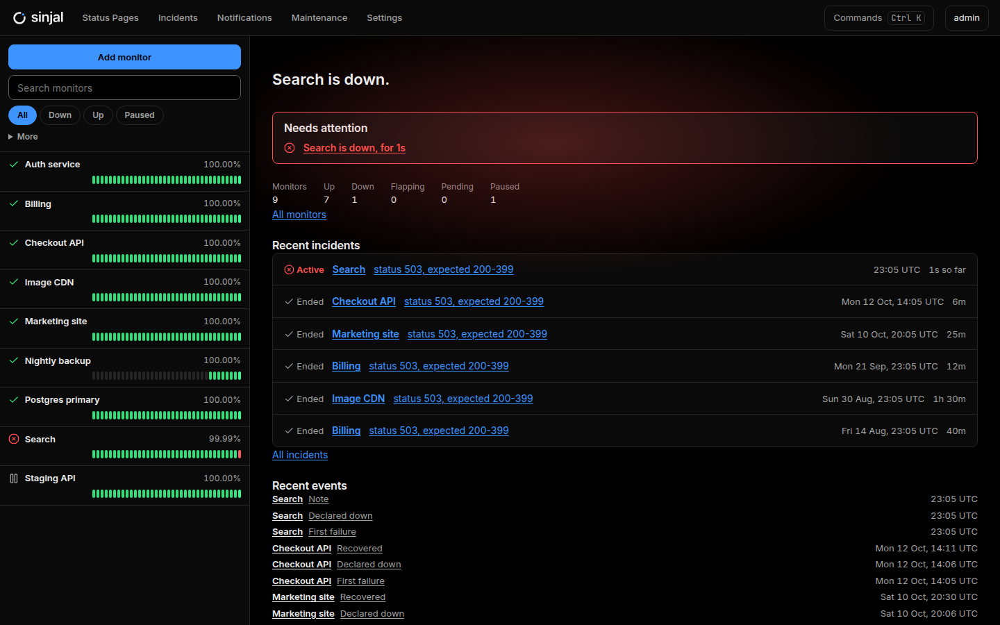
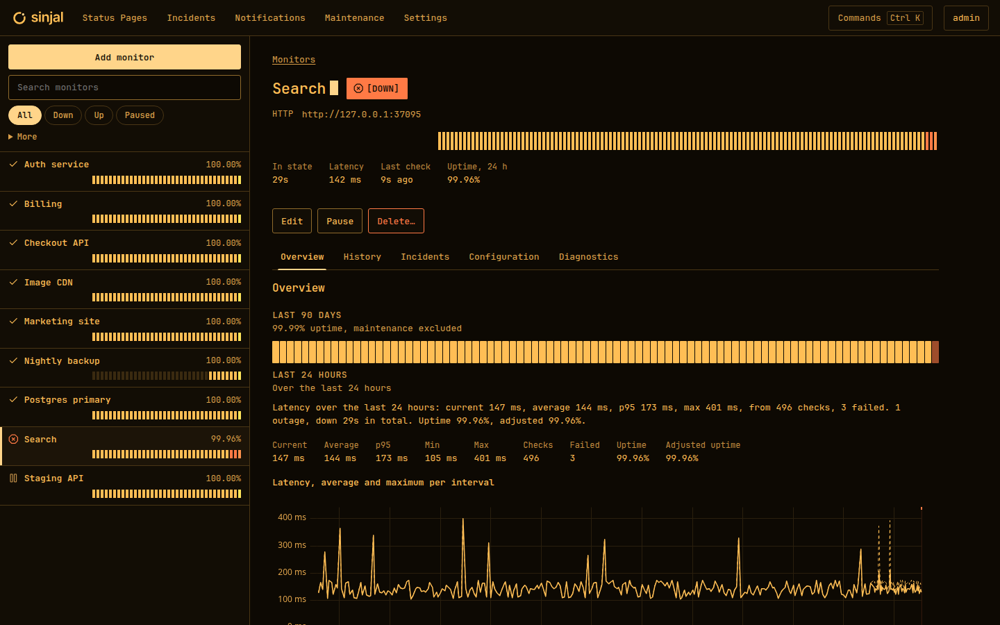
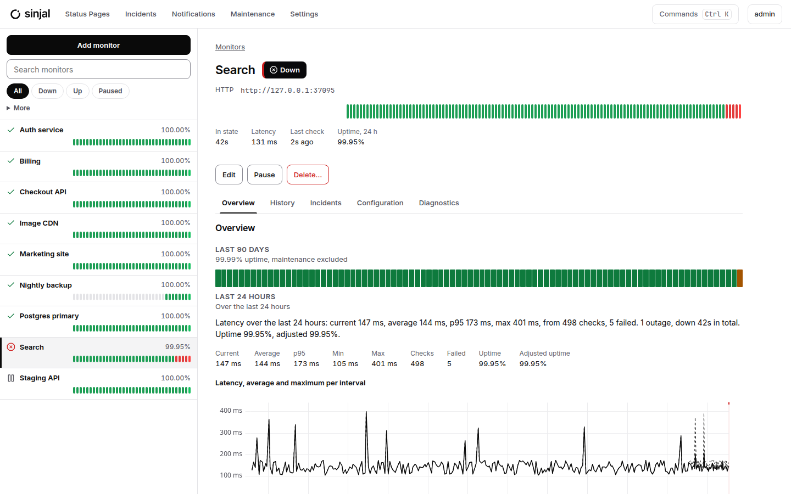
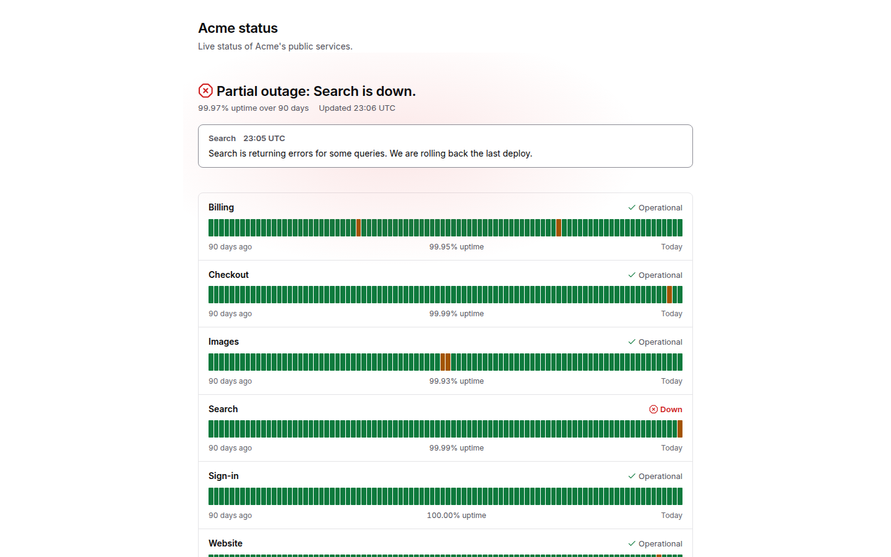
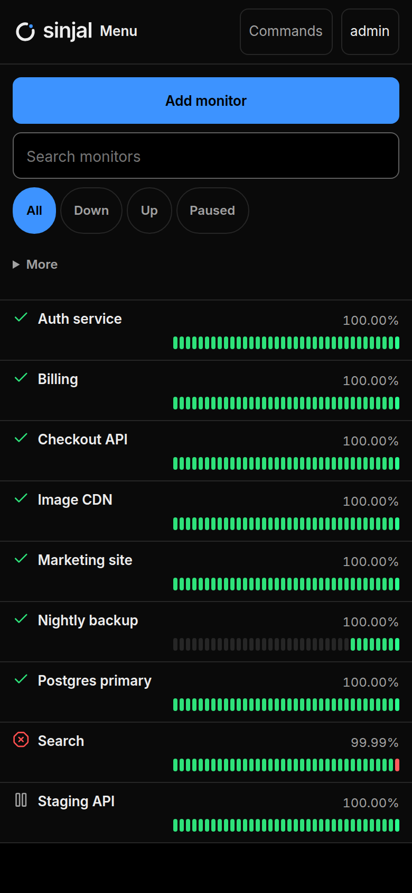

<h1></h1>

**Uptime monitoring without the overhead.**

Sinjal is a small, fast, self-hosted uptime monitor. It is one Go binary with one SQLite database, made for a single technical owner who wants to know when something is down. It does that well, then stays out of the way.

> **Status: pre-release.** Sinjal v1 is in development. There is no tagged release or container image yet. You can build and run it from source today.



<table>
  <tr>
    <td width="50%"></td>
    <td width="50%"></td>
  </tr>
  <tr>
    <td width="50%"></td>
    <td width="50%" align="center"></td>
  </tr>
</table>

<sub>Screenshots come from `make screenshots`, which runs Sinjal on demo data.</sub>

## Why Sinjal

- **One process, one data directory.** SQLite only. No Redis, PostgreSQL, message broker, Node runtime or worker to run beside it.
- **Light.** Built for under 50 MB of RAM when idle, a start in under a second and under 100 KB of compressed JavaScript in the browser.
- **Honest outages.** A failure is retried before anything is declared down, flapping is recognised, and incidents are durable records, not log lines.
- **Deliberately narrow.** Sinjal is not Uptime Kuma, Grafana or Prometheus. It watches endpoints, tells you when they break and shows the history. Metrics, tracing and log shipping are out of scope ([non-goals](docs/25_NON_GOALS.md)).

## Features

- **Five monitor types:** HTTP(S), TCP port, ping (ICMP), DNS and heartbeat (your job calls Sinjal).
- **Incidents:**
  - a confirmation retry before DOWN
  - flapping detection
  - maintenance windows (one-time, daily, weekly) that can silence notifications, with uptime shown both raw and adjusted for maintenance
  - parent dependencies, so one root cause raises one alert
  - incident timelines with notes
- **Notifications:**
  - Email (SMTP), Discord, Telegram and webhooks
  - notification profiles with quiet hours and a simulator
  - channel health on the dashboard
- **History:** response-time charts and uptime from 24 hours up to a year. Raw results are kept for 7 days, then rolled up (5-minute, hourly and daily buckets).
- **Status pages:**
  - as many as you need
  - public, signed-in only, password-protected or unlisted
  - custom domains, a JSON endpoint and an incident feed
  - published notes
  - internal addresses never shown by default
- **A calm, fast interface:**
  - three themes: Stark (with an optional Ambient light), Terminal and Daylight
  - compact and comfortable density
  - live updates over Server-Sent Events
  - a command palette (Ctrl/Cmd+K) and keyboard shortcuts
  - search, filters and saved views
  - works on phones
- **Security:** passwords (Argon2id), passkeys and TOTP for the admin, read-only viewer accounts, re-authentication before sensitive actions, CSRF protection, a strict Content Security Policy, and an audit log. Secrets are encrypted at rest.

## Quick start

You need Go 1.27 or newer. No Node or asset build step is involved.

```bash
git clone https://github.com/drilonrecica/sinjal.git
cd sinjal
make build                     # produces ./sinjal
SINJAL_DATA_DIR=./data ./sinjal serve
```

On its first start Sinjal logs a one-time setup link:

```text
Initial setup: http://localhost:8080/setup?token=…
```

Open it to create the admin account. The token changes on every start until an admin exists.

Lost the admin password? Run `sinjal reset-admin`, with `-login` when there is more than one admin and `-remove-passkeys` to also remove passkeys. It works while the server is running.

**Docker** will be the primary way to run Sinjal once the first release ships: one container, one volume mounted at `/data`, port 8080. See [deployment](docs/16_DEPLOYMENT.md).

## Configuration

Sinjal is configured with environment variables. Unknown `SINJAL_*` variables are rejected at startup, so typos do not pass silently.

| Variable | Default | Meaning |
|---|---|---|
| `SINJAL_DATA_DIR` | `/data` | Where the database and master key live. Back up this directory. |
| `SINJAL_LISTEN` | `:8080` | Address to listen on. |
| `SINJAL_BASE_URL` | none | Public URL of the app, e.g. `https://sinjal.example.com`. Used for the setup link and to send visitors of custom status-page domains to sign in. |
| `SINJAL_TRUSTED_PROXIES` | none | Comma-separated IPs or CIDRs whose `X-Forwarded-*` headers are trusted. |
| `SINJAL_TIMEZONE` | `UTC` | Time zone for maintenance windows and daily figures. |
| `SINJAL_WORKERS` | 4 × CPUs, 8 to 32 | Concurrent checks (1 to 256). |
| `SINJAL_LOG_FORMAT` | `text` | `text` or `json`. |
| `SINJAL_LOG_LEVEL` | `info` | `debug`, `info`, `warn` or `error`. |

Run Sinjal behind a reverse proxy that terminates TLS. Live updates need it to pass streaming responses unbuffered; Caddy and Traefik do so out of the box ([reverse proxy notes](docs/16_DEPLOYMENT.md#reverse-proxy)). Validation rules for every setting: [docs/38](docs/38_CONFIG_VALIDATION.md).

## Monitor types

| Type | Checks | Up when |
|---|---|---|
| HTTP(S) | a URL, with method, headers, authentication and body | the status matches (default 200–399) and every body and JSON assertion holds |
| TCP port | `host:port` | a connection opens within the timeout |
| Ping (ICMP) | a host name or IP address, IPv4 or IPv6 | an echo reply comes back within the timeout |
| DNS | A, AAAA, CNAME, MX, TXT or NS records of a name, from the system's resolvers or a chosen one | records exist, and contain all (or any) of the expected values when given |
| Heartbeat | nothing: your job calls Sinjal | a beat arrives at least every expected interval plus grace |

All types share the same defaults:
- a check every 30 s
- a confirmation retry 5 s after a first failure
- DOWN after two failures in a row
- UP again after one success

### Heartbeats

A heartbeat monitor shows its push URL once, when it is created or regenerated (regenerating needs a recent sign-in). Send a beat at the end of your job:

```bash
curl -fsS -m 10 -X POST https://sinjal.example.com/api/v1/heartbeat/<token>
```

### Ping permissions

Sinjal pings without root. It needs one of these:
- unprivileged ping sockets allowed for its group (`net.ipv4.ping_group_range`)
- the `CAP_NET_RAW` capability

Docker 20.10+ and most systemd distributions allow ping sockets out of the box; Podman and some hardened runtimes do not. Without either, ping monitors report a clear "permission" error instead of a false outage. Settings for Docker, Podman, Kubernetes and the native binary: [ICMP](docs/16_DEPLOYMENT.md#icmp).

## Project model

Sinjal is open source under the [MIT licence](LICENSE) and author-driven:
- **Issues** (bug reports, focused suggestions) are welcome.
- **Pull requests are not accepted.** See [CONTRIBUTING](CONTRIBUTING.md).
- **Security issues:** report them privately, as described in [SECURITY](SECURITY.md).

## Development

```bash
make dev            # run with ./.dev-data
make lint           # gofmt, go vet, staticcheck, templ format and generated-code checks
make test-race      # all tests with the race detector
make test-browser   # chromedp browser suite (needs Chrome or Chromium)
make generate       # regenerate templ output after editing .templ files
```

The documents in [`docs/`](docs/) are the specification and are normative: when code and docs disagree, the docs win unless the owner amends them. Start with [AGENTS.md](AGENTS.md), [the master spec](docs/00_MASTER_SPEC.md), the [implementation plan](docs/23_IMPLEMENTATION_PLAN.md) and the [acceptance criteria](docs/24_ACCEPTANCE_CRITERIA.md). Progress is logged in [the implementation checklist](docs/IMPLEMENTATION_CHECKLIST.md).
